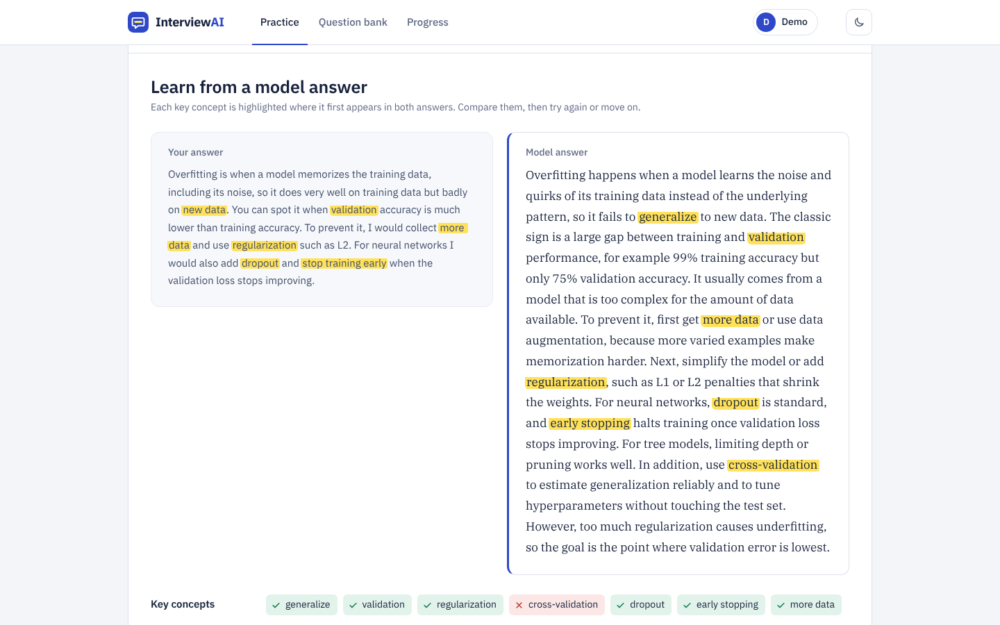
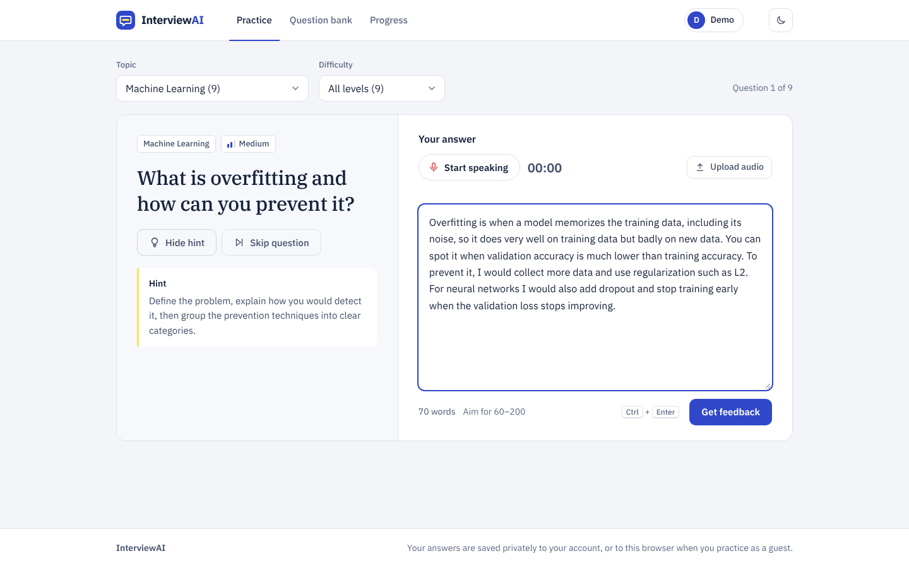
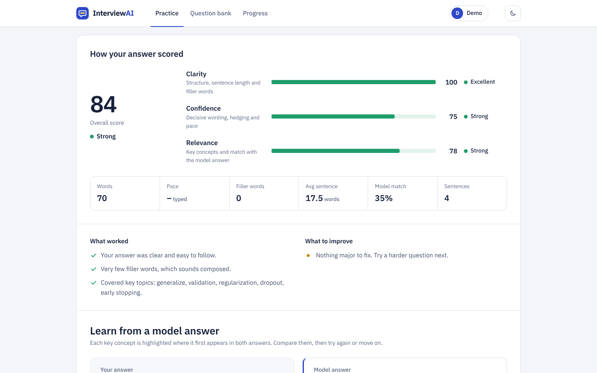
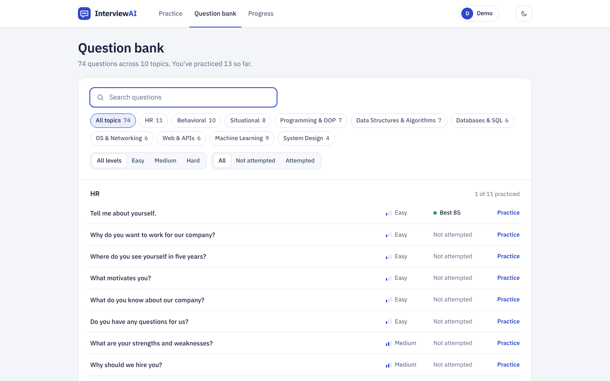
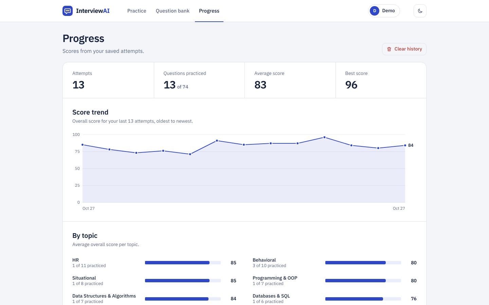
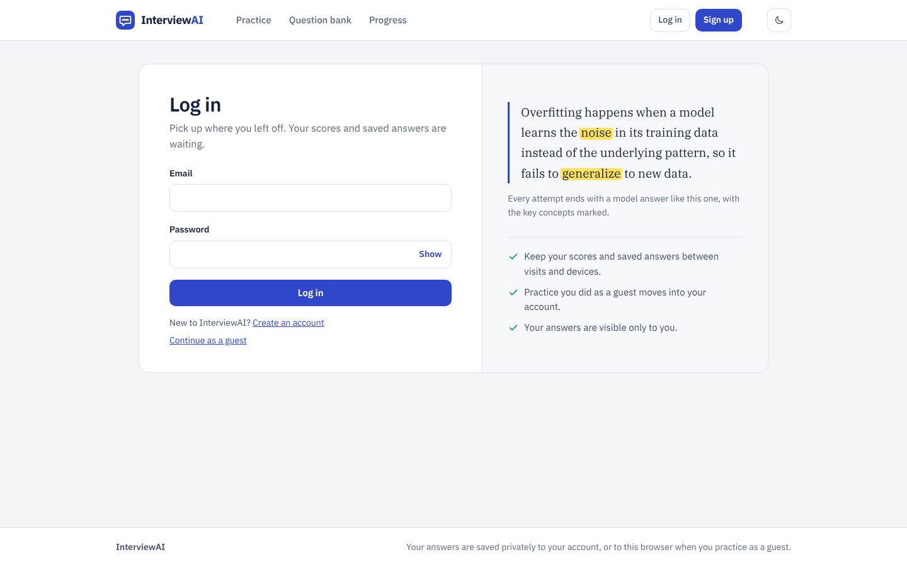
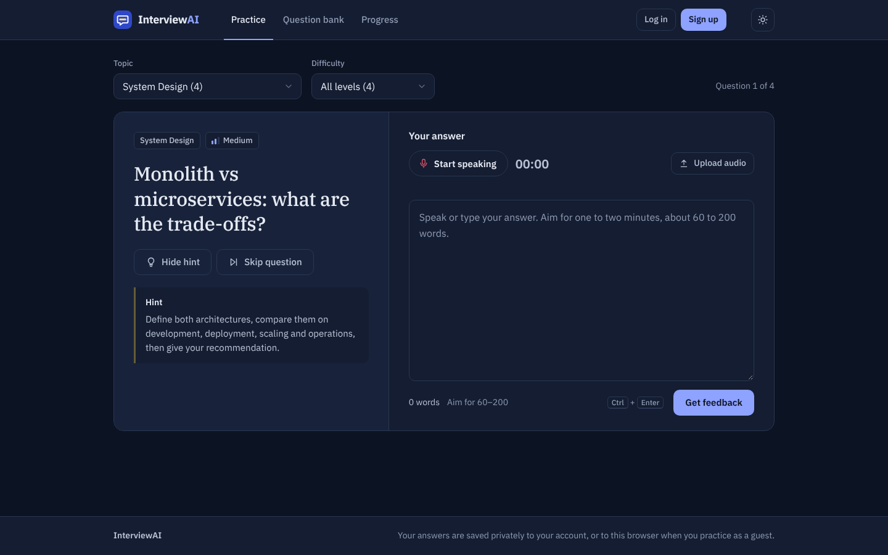
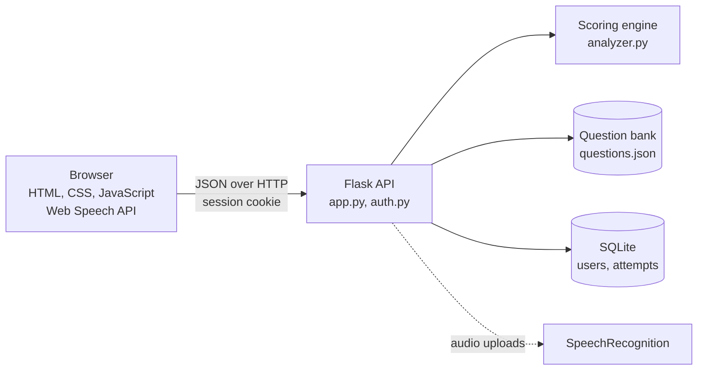

# InterviewAI

Practice interview questions out loud, get instant NLP-based feedback, and learn from a model answer after every attempt.




## Features

- **74 interview questions across 10 topics**: HR, Behavioral, Situational, Programming & OOP,
  Data Structures & Algorithms, Databases & SQL, OS & Networking, Web & APIs, Machine Learning and
  System Design, each tagged Easy, Medium or Hard.
- **Answer by voice or text**: live speech-to-text in the browser, audio file upload, or typing.
- **Instant scorecard** for clarity, confidence and relevance, plus speaking pace, filler words and
  how closely the answer matches the model answer.
- **Learn after you attempt**: the model answer appears only after you answer, next to yours, with
  each key concept highlighted, a checklist of concepts you covered or missed, what interviewers
  look for, common mistakes and likely follow-up questions. An optional hint helps before you start.
- **Accounts with a guest mode**: anyone can practice without signing up; creating an account keeps
  your progress, and practice done as a guest moves into the new account.
- **Progress tracking**: score trend chart, average score by topic with your weakest topic
  suggested, and every saved answer.
- **Question bank** with search and filters by topic, difficulty and attempted status.
- Light and dark themes, a responsive layout, keyboard navigation and screen-reader labels.

## Screenshots

| Practice | Scorecard |
|---|---|
|  |  |
| **Question bank** | **Progress** |
|  |  |
| **Log in** | **Dark theme** |
|  |  |

## Architecture



The frontend is plain HTML, CSS and JavaScript with no build step, served by Flask from the same
origin. The backend exposes a small JSON API; all data access is scoped to the logged-in user, or
to the browser's guest session.

### How answers are scored

| Score | What it measures |
|---|---|
| Clarity | Answer length, sentence length, filler words, vocabulary variety and linking words |
| Confidence | Hedging ("I think", "maybe"), filler words, action verbs and speaking pace; tone (VADER sentiment) for HR, behavioral and situational questions only |
| Relevance | Key-concept coverage (65%) plus TF-IDF cosine similarity to the model answer (35%); behavioral answers are also checked for the STAR structure |
| **Overall** | 30% clarity + 30% confidence + 40% relevance |

Key concepts accept alternative phrasings (`"lead|led|leadership"`) and match at the start of a
word, so "led" counts for leadership but "put" does not match "input". Common phrases such as
"I'd like to" or "RIGHT JOIN" are not counted as fillers. On a set of calibration answers, strong
answers score 77-87, partial answers 39-49 and off-topic answers about 41.

## Tech stack

| Area | Technology |
|---|---|
| Backend | Python, Flask, SQLite |
| NLP / ML | scikit-learn (TF-IDF, cosine similarity), VADER sentiment, rule-based filler, hedge and STAR detection |
| Speech | Web Speech API in the browser; SpeechRecognition and pydub for uploaded audio |
| Frontend | HTML, CSS, vanilla JavaScript, SVG charts |
| Auth | Werkzeug (scrypt) password hashing, signed session cookies |
| Quality | 25 unit and API tests (`unittest`), GitHub Actions CI |

## Getting started

Requires Python 3.10 or newer. Clone or download this repository, then:

```bash
cd interview-ai/backend
python -m venv venv
source venv/bin/activate          # Windows: venv\Scripts\activate
pip install -r requirements.txt
python app.py
```

Open http://127.0.0.1:5000. Live voice input works in Chrome and Edge. Everything else also works
offline, because the fonts are bundled.

## Configuration

All settings are optional environment variables.

| Variable | Default | Purpose |
|---|---|---|
| `INTERVIEWAI_SECRET_KEY` | A random key saved in `backend/instance/` | Signs session cookies. Set your own in production. |
| `INTERVIEWAI_SECURE_COOKIES` | Off | Set to `1` when the site is served over HTTPS. |
| `INTERVIEWAI_DB` | `backend/interview.db` | Path of the SQLite database. |
| `INTERVIEWAI_CORS_ORIGINS` | None | Comma-separated origins, needed only if the frontend is hosted separately. |
| `INTERVIEWAI_DEBUG` | `1` | Set to `0` to turn off the Flask debugger. |
| `HOST`, `PORT` | `127.0.0.1`, `5000` | Address used by `python app.py`. |

### Deploying

Run the app with a production WSGI server instead of `python app.py`, for example
`pip install gunicorn` and then `gunicorn --chdir backend app:app` on Linux. Set
`INTERVIEWAI_SECRET_KEY` and `INTERVIEWAI_SECURE_COOKIES=1`, and serve it over HTTPS, because
browsers only allow microphone access on secure pages. SQLite and the in-memory login rate limiter
suit a single server; use a managed database and a shared store such as Redis to run several.

## Testing

```bash
cd backend
python -m unittest discover tests -v
```

The 25 tests cover:

- **Question bank**: every key concept appears in its model answer, model answers contain no filler
  or hedge words, and each model answer scores at least 80 with the app's own scorer.
- **Scoring engine**: keyword matching, filler detection, and stronger answers outscoring weaker ones.
- **API**: model answers are hidden before an attempt, filters work, and bad input returns clear errors.
- **Accounts**: password hashing, validation, duplicate emails, login rate limiting, data isolation
  between users and guests, guest practice moving into a new account, password change (which logs
  out other devices) and account deletion.

GitHub Actions runs the suite on Python 3.10 and 3.13 for every push and pull request.

## Security

- Passwords are hashed with scrypt and never stored or returned in plain text.
- Session cookies are signed, HttpOnly and SameSite=Lax (Secure on HTTPS). Changing a password ends
  sessions on other devices.
- Failed logins are limited to 5 per 15 minutes for each email and IP address, and an unknown email
  gets the same error as a wrong password.
- Every query is parameterized and scoped to the current user or guest.
- The API is same-origin by default (CORS is off unless configured), and request sizes are capped.

## API

| Method | Path | Description |
|---|---|---|
| GET | `/api/questions?category=&difficulty=` | Questions (without answers), topic groups and difficulty levels |
| GET | `/api/questions/random?category=&difficulty=&exclude=` | One random question |
| POST | `/api/analyze` | `{question_id, answer, duration}`: scores, feedback, and the `learn` block (model answer, tips, mistakes, follow-ups) |
| POST | `/api/transcribe` | Multipart `audio` file: `{text, duration}` |
| GET | `/api/history?limit=30` | The current user's attempts, averages, and per-question and per-topic stats |
| DELETE | `/api/history` | Clears the current user's attempts |
| GET | `/api/auth/me` | The logged-in user, or `null` for guests |
| POST | `/api/auth/register` | `{name, email, password}`: creates an account and logs in |
| POST | `/api/auth/login` | `{email, password}` |
| POST | `/api/auth/logout` | Ends the session |
| POST | `/api/auth/password` | `{current, new}`: changes the password |
| DELETE | `/api/auth/account` | `{password}`: deletes the account and its attempts |

## Project structure

```
backend/
  app.py               Flask app: question, scoring and history API; serves the frontend
  auth.py              Accounts: register, log in, log out, change password, delete account
  analyzer.py          Scoring engine: clarity, confidence, relevance, sentiment, STAR
  questions.py         Loads and validates the question bank
  data/questions.json  74 questions with model answers, key concepts, tips, mistakes and follow-ups
  db.py                SQLite storage for users and attempts (migrates older databases)
  tests/test_app.py    Unit and API tests
frontend/
  index.html, style.css, app.js
  fonts/               IBM Plex Sans and IBM Plex Serif (SIL Open Font License)
docs/screenshots/      Images used in this README
```

## Adding questions

Questions live in `backend/data/questions.json`. Restart the server after editing, then run the tests.

```json
{
  "id": 75,
  "category": "Behavioral",
  "difficulty": "Medium",
  "question": "Tell me about a time you handled a tight deadline.",
  "keywords": ["deadline", "prioritize|prioritiz|prioritis", "communicate|communicat", "result|outcome", "learned|learnt"],
  "model_answer": "During my internship ... As a result ... I learned ...",
  "tips": ["Shown as the hint before an attempt, so describe the approach, not the answer.", "...", "..."],
  "mistakes": ["...", "..."],
  "follow_ups": ["...?", "...?"]
}
```

- Keep `id` values unique and unchanged, so saved history stays linked to its question.
- In `keywords`, `|` separates accepted alternatives. The first term is the label learners see, so
  make it a whole word; later terms can be stems, such as `prioritiz`.
- `model_answer` is shown after an attempt and is the reference for the relevance score. Avoid
  filler and hedge words in it, because the scorer penalizes them.
- `tips[0]` doubles as the pre-attempt hint.

## Roadmap

- Semantic matching with sentence embeddings, so synonyms of key concepts get credit
- Timed mock-interview mode with a summary report
- Password reset by email

## License

[MIT](LICENSE)
